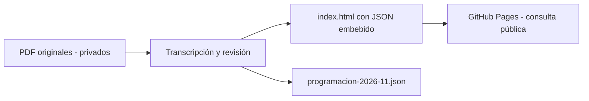

# IDMJI — Programación Bois-des-Filion (noviembre 2026)

**Versión:** MVP 1.0 de consulta, derivada de la interfaz v6. **Estado:** preparado para revisión; publicación pendiente.

## Objetivo
Consultar desde un navegador la programación **ya aprobada** de noviembre de 2026, sin generar ni editar asignaciones.

## Funciones
- **Hoy:** abre la fecha local de `America/Toronto` dentro de noviembre; las flechas permiten navegar entre el 1 y el 30.
- **Mes:** muestra los días con asignaciones.
- Se muestra el tipo de servicio y su hora: domingo y jueves Enseñanza; lunes Estudio bíblico; martes y miércoles Alabanzas.
- Incluye Púlpito (Introducción/Enseñanza o Apertura/Cierre) y las funciones transcritas del otro PDF.
- Mensaje final de puntualidad, privacidad y coordinación de reemplazos.

## Arquitectura
Sitio **estático**, HTML/CSS/JavaScript sin dependencias externas. `index.html` contiene los datos embebidos y funciona de manera autónoma; `programacion-2026-11.json` es una copia legible para trazabilidad y futuras evoluciones. **La web no carga ese JSON**, por lo que cambiar solo el JSON no actualiza la pantalla.

## Fuentes y trazabilidad
- `Program Nov BDF Soni Mic Diez Pas.pdf` (2 páginas).
- `Program Nov BDF Pulpito.pdf` (1 página).
Los PDF **no se incluyen** en este repositorio público porque contienen nombres completos. Se preserva la programación del documento original, aunque difiera de reglas de programación futura.

## Privacidad
Los nombres publicados se reducen a nombre e inicial; sin embargo, **fecha + función + nombre abreviado** aún puede identificar personas y revelar vinculación religiosa. Antes de publicar se requiere autorización/base jurídica validada por IDMJI, revisión del JSON y confirmación de responsables. `noindex` no restringe el acceso.

## Ejecución local
Abrir `index.html` en un navegador. No requiere servidor ni instalación.

## Publicación en GitHub Pages
1. Crear repositorio público dedicado, por ejemplo `idmji-programaciones`, bajo la organización autorizada.
2. Subir `index.html`, `programacion-2026-11.json`, `.nojekyll`, `README.md` y `docs/`. **No subir los PDF originales**.
3. En **Settings → Pages**, elegir **Deploy from a branch**, rama `main`, carpeta `/(root)` y guardar.
4. Abrir la URL mostrada por GitHub y validar Hoy/Mes desde móvil y escritorio.
5. Si se requiere retirar información, borrar la publicación y evaluar cachés, forks, historial y copias externas.

## Actualización / reversión
- Para actualizar un nombre o fecha, modificar **tanto** el JSON embebido de `index.html` como `programacion-2026-11.json` y comprobar que coinciden.
- Crear un commit con la corrección y verificar el despliegue.
- Reversión: revertir el commit anterior o desactivar Pages. **Desactivar Pages no garantiza eliminar copias previamente obtenidas.**

## Exclusiones
No hay autenticación, base de datos, APIs, edición, sustituciones en tiempo real ni generación de diciembre.

## Validaciones pendientes
Ver `docs/VALIDACION.md`.
