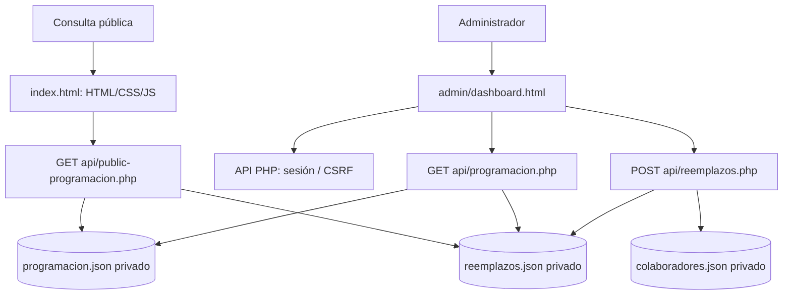

# IDMJI — Programación Bois-des-Filion

**Versión funcional:** v1.1 (noviembre 2026)  
**Estado:** sitio publicado; desarrollo pausado tras incorporar numeración de guías.  
**URL operativa:** https://dydata.ca/idmji/  
**Administración:** https://dydata.ca/idmji/admin/  
**Hospedaje:** MochaHost / cPanel (PHP).  
**Importante:** este repositorio contiene documentación histórica del MVP estático. **No se ha confirmado que los archivos fuente de producción estén sincronizados con GitHub.** No desplegar la versión estática histórica encima de producción.

## Alcance implementado

- Consulta pública por día (**Hoy**, flechas) y por **Mes**, con asignaciones y horas.
- Programación de noviembre de 2026 proveniente de los dos PDF originales; no se generan asignaciones automáticamente.
- Panel administrativo con autenticación y formulario de reemplazos.
- API PHP administrativa para consultar programación y registrar reemplazos con control de sesión y CSRF.
- Almacenamiento privado de programación, colaboradores, reemplazos e historial de auditoría, fuera de `public_html`.
- Endpoint público de solo lectura `/idmji/api/public-programacion.php`, que devuelve la programación con los reemplazos aplicados, sin catálogo administrativo ni historial.
- Numeración de guías visible en la programación pública:
  - **Alabanzas:** «Guía de coros N.º 27/43» el **2026-11-04**; máximo 43, luego vuelve a 1.
  - **Enseñanza:** «Guía de himnos y coros N.º 60/82» el **2026-11-05**; máximo 82, luego vuelve a 1.
  - **Estudio bíblico:** sin guía.
- Las secuencias se calculan en el navegador con base en los servicios del mes cargado; **la continuidad entre meses futuros todavía no está implementada**.

## Arquitectura actual

La programación original se conserva; los reemplazos se guardan separadamente y se aplican a una copia en memoria para las consultas. El HTML público aún contiene una copia de la programación como dato inicial; una solicitud `fetch()` consulta la API y sustituye los datos al recibir respuesta. **Pendiente:** eliminar esa copia embebida y gestionar explícitamente el estado de carga/error para evitar información desactualizada.

## Rutas operativas conocidas

| Componente | Ruta en el servidor |
|---|---|
| Sitio público | `/home/hruiz76/public_html/idmji/index.html` |
| Administración | `/home/hruiz76/public_html/idmji/admin/` |
| API PHP | `/home/hruiz76/public_html/idmji/api/` |
| Datos privados | `/home/hruiz76/idmji-data/` |

No subir a GitHub `admin.json`, `security.php`, datos privados, credenciales, copias de respaldo ni los PDF con nombres completos. Antes de versionar código de producción, revisar configuración, datos personales y secretos.

## Evidencias de esta sesión

- El usuario confirmó que la página pública y el panel administrativo cargan correctamente.
- El usuario confirmó que las secuencias de guías se muestran correctamente.
- La creación del endpoint público y los cambios de HTML se realizaron mediante comandos ejecutados por el usuario en MochaHost.
- **No se ha completado una prueba extremo a extremo de registro de reemplazo real**, ni se ha verificado un cambio de nombre reflejado en la página pública.
- **No se ha realizado despliegue desde GitHub**; el servidor MochaHost es la instalación operativa.

## Retomar el trabajo

1. Confirmar que el sitio continúa operativo y disponer de respaldo de producción.
2. Revisar el contrato del endpoint público y la coherencia de reemplazos en el panel.
3. Ejecutar una única prueba autorizada de reemplazo, o una prueba aislada sin modificar la programación oficial; comprobar persistencia, auditoría y visualización pública.
4. Eliminar la duplicación de datos del HTML público para que la API sea la única fuente de lectura.
5. Preparar una exportación revisada y sin secretos del código operativo al repositorio; no reemplazar producción por los archivos históricos.
6. Diseñar continuidad de numeración entre meses y futura programación de diciembre.
7. Actualizar el checklist de aceptación y registrar evidencias.

## Seguridad y privacidad

Este repositorio es público. Nombres abreviados junto con fechas, funciones y lugar pueden revelar información sensible sobre participación religiosa. La marca `noindex` **no es un control de acceso**. Confirmar autorización de publicación, minimizar datos y limitar accesos administrativos. Los archivos privados deben permanecer fuera de `public_html`.

## Documentación

- [Validación y pendientes](docs/VALIDACION.md)
- [Arquitectura, operación y decisiones](docs/ARQUITECTURA-V1.1.md)
- `programacion-2026-11.json` y el `index.html` histórico son artefactos del MVP 1.0; no deben considerarse automáticamente la fuente de producción v1.1.
