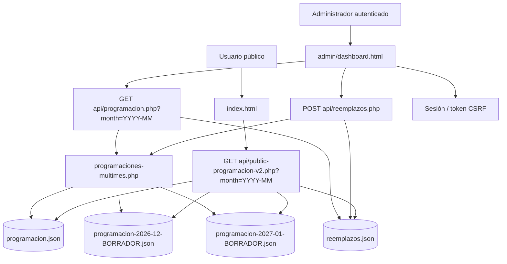

# IDMJI v1.3 — Arquitectura, despliegue y registro de incidencias

**Fecha:** 2026-11-15  
**Sistema:** Programaciones IDMJI, Bois-des-Filion  
**Entorno:** MochaHost / cPanel / PHP  
**Estado:** desplegado; consulta multimes validada; **registro administrativo bloqueado por incidencia CSRF pendiente de diagnóstico**.  
**Producción:** https://dydata.ca/idmji/  
**Administración:** https://dydata.ca/idmji/admin/

> Este documento registra evidencias comunicadas durante el despliegue. No implica que GitHub contenga una copia sincronizada del código PHP de producción. No desplegar artefactos históricos del repositorio sobre MochaHost.

## 1. Objetivo y alcance

Extender la consulta y gestión administrativa de reemplazos a **noviembre de 2026, diciembre de 2026 y enero de 2027**, sin modificar los archivos originales de programación. Los reemplazos se almacenan separadamente y se superponen a las consultas.

## 2. Arquitectura implementada



Los tres archivos de programación permanecen privados bajo `/home/hruiz76/idmji-data/`; el sufijo BORRADOR en diciembre y enero forma parte del nombre del archivo y no indica que esos meses no estén publicados.

## 3. Componentes y rutas

| Componente | Ruta operativa | Cambio v1.3 |
|---|---|---|
| Cargador multimes | `/home/hruiz76/idmji-data/programaciones-multimes.php` | Nuevo; lista blanca de meses, carga por mes y consolidación |
| Consulta administrativa | `/home/hruiz76/public_html/idmji/api/programacion.php` | Parámetro `month`, filtrado de reemplazos por mes |
| Escritura administrativa | `/home/hruiz76/public_html/idmji/api/reemplazos.php` | Validación con programación consolidada |
| Panel administrativo | `/home/hruiz76/public_html/idmji/admin/dashboard.html` | Selector de mes y consulta contextual |
| Consulta pública | `/home/hruiz76/public_html/idmji/api/public-programacion-v2.php` | Ya soportaba tres meses; no modificado en despliegue |
| Persistencia | `/home/hruiz76/idmji-data/reemplazos.json` | No modificado directamente durante despliegue |
| Paquete preparado | `/home/hruiz76/idmji-data/release-v1.3/` | Copias verificadas de tres componentes |
| Respaldo previo | `/home/hruiz76/idmji-reemplazos-pre-v1.3.tar.gz` | Respaldo disponible antes de activar v1.3 |

La API administrativa exige sesión; la escritura usa POST y protección CSRF. La lógica de almacenamiento contempla bloqueo de archivo, guardado atómico y auditoría. **El fallo CSRF observado impide afirmar que el flujo de escritura publicado funciona.**

## 4. Despliegue realizado

1. Preparación de tres candidatos privados para API de consulta, API de reemplazos y dashboard.
2. Verificación de sintaxis PHP y JavaScript del candidato; prueba aislada de reemplazos en los tres meses con archivo de almacenamiento de prueba.
3. Preparación de `release-v1.3` y verificación de integridad.
4. Comprobación de `php -l` para las dos APIs de la versión preparada.
5. Copia a archivos temporales junto a los destinos y sustitución atómica **individual** de los tres componentes administrativos. No fue una transacción atómica conjunta.
6. Verificación pública HTTP y pruebas manuales del panel.

**Evidencia de publicación comunicada:**
```text
programacion.php: ACTIVADO
reemplazos.php: ACTIVADO
dashboard.html: ACTIVADO
IDMJI v1.3: archivos administrativos publicados
```

## 5. Matriz de pruebas y evidencias

| Prueba | Resultado / evidencia | Estado |
|---|---|---|
| Sintaxis PHP del paquete | Dos mensajes `No syntax errors detected` | Aprobada |
| Presencia del dashboard | `Paquete v1.3: listo para activación` | Aprobada |
| Consulta pública noviembre | HTTP 200 | Aprobada |
| Consulta pública diciembre | HTTP 200 | Aprobada |
| Consulta pública enero | HTTP 200 | Aprobada |
| Control de acceso API administrativa | Usuario confirmó ejecución, pero no compartió códigos exactos | Confirmación verbal; evidencia HTTP pendiente |
| Selector y consulta de tres meses | Usuario confirmó que los tres funcionan | Aprobada visualmente |
| Formulario de reemplazo para enero | Usuario confirmó visualización correcta sin guardar | Aprobada visualmente |
| Escritura y auditoría en almacenamiento privado de prueba | Tres reemplazos de prueba; validadores aprobados | Aprobada en entorno aislado |
| Registro real mediante API publicada | Mensaje `Token CSRF no disponible` | **Bloqueada / incidencia abierta** |
| Reflejo de reemplazo real en consulta pública | No ejecutado | Pendiente |

## 6. Incidencia abierta INC-2026-11-15-CSRF

**Síntoma:** el formulario «Gestión de reemplazos» muestra `Token CSRF no disponible` al intentar el reemplazo. La captura corresponde al **2026-12-03**, rol **Diezmo**, con un colaborador original y un sustituto seleccionados. No se publica aquí el detalle nominal por privacidad.

**Impacto:** la lectura administrativa multimes funciona, pero no puede darse por validado el registro de reemplazos en producción.

**Causas posibles, aún no verificadas:**
- Sesión administrativa expirada o no reconocida al solicitar el token.
- Error de ruta, respuesta o procesamiento del endpoint de obtención de CSRF en el dashboard v1.3.
- Diferencia entre el contrato esperado por el cliente y la respuesta del servidor.

**Próximo diagnóstico controlado:**
1. Cerrar sesión, volver a autenticar y repetir la vista previa sin guardar.
2. Si persiste, inspeccionar en el navegador la solicitud de token: URL, código HTTP, cuerpo de respuesta y cookies de sesión, sin compartir tokens ni cookies.
3. Revisar la implementación del flujo CSRF y los logs pertinentes; corregir solo la causa raíz.
4. Validar de nuevo autenticación y la obtención del token antes de permitir escrituras.
5. Ejecutar una sustitución real únicamente cuando exista un caso legítimo autorizado; verificar persistencia, auditoría y consulta pública.

**No se ha demostrado que el reemplazo mostrado en la captura se haya guardado.**

## 7. Seguridad, privacidad y riesgos

- Los JSON privados, secretos, sesiones, archivos de auditoría y respaldos no deben versionarse en un repositorio público.
- No exponer rutas administrativas ni bases de datos sin autenticación.
- Minimizar información que pueda identificar participación religiosa; `noindex` no es una barrera de acceso.
- Conservar el principio de fuente original inmutable y superposición de reemplazos.
- Riesgo de versión mixta durante despliegues de varios archivos: programar ventana sin operaciones administrativas y comprobar cada endpoint inmediatamente.
- No afirmar integridad de datos o eficacia de CSRF hasta concluir las pruebas pendientes.

## 8. Recuperación / reversión

**Requisitos previos:** aprobación explícita, acceso al servidor, identificación de archivos afectados y confirmación de ausencia de operaciones administrativas concurrentes.

1. Confirmar existencia e integridad del respaldo `/home/hruiz76/idmji-reemplazos-pre-v1.3.tar.gz`.
2. Inspeccionar el contenido del archivo y determinar únicamente los tres componentes administrativos que deben restaurarse.
3. Respaldar primero los archivos v1.3 actualmente publicados.
4. Restaurar los componentes administrativos anteriores mediante archivos temporales y sustitución controlada.
5. **No restaurar `reemplazos.json` desde el respaldo**: podría sobrescribir reemplazos legítimos posteriores.
6. Comprobar autenticación, lectura administrativa, consulta pública y logs.

No ejecutar una extracción indiscriminada del tarball sobre producción.

## 9. Decisiones arquitectónicas

**ADR-001 — Programaciones originales inmutables.** Se conserva cada JSON mensual; los reemplazos se registran en almacenamiento separado. Beneficio: trazabilidad y reversibilidad.

**ADR-002 — Cargador privado multimes con lista blanca.** Solo se admiten `2026-11`, `2026-12` y `2027-01`. Beneficio: evita rutas arbitrarias y acota el alcance.

**ADR-003 — Validación consolidada y presentación filtrada.** La API de escritura valida contra 92 días; la API administrativa de lectura filtra el mes solicitado. Beneficio: reglas coherentes y panel contextual.

**ADR-004 — Publicación controlada sin alterar la API pública.** Solo se sustituyeron tres componentes administrativos; los archivos originales y la API pública v2 no se modificaron durante el despliegue.

## 10. Pendientes y criterios de cierre

- [ ] Diagnosticar y resolver INC-2026-11-15-CSRF.
- [ ] Obtener evidencia explícita de códigos HTTP de acceso administrativo sin sesión.
- [ ] Validar escritura real autorizada, auditoría y proyección pública.
- [ ] Revisar reglas de elegibilidad y conflictos entre funciones antes de ampliar el flujo.
- [ ] Sincronizar código operativo revisado y sin secretos con GitHub; el repositorio actual no es fuente de despliegue verificada.
- [ ] Actualizar documentación de operación y checklist tras resolver la incidencia.

## 11. Registro de cambios

**v1.3 (2026-11-15):** consulta y panel administrativo para noviembre 2026–enero 2027; cargador privado multimes; API administrativa de reemplazos con programación consolidada; despliegue y verificaciones de lectura. Incidencia CSRF abierta en escritura.

**Versiones anteriores:** consultar README y documentos históricos del repositorio. No asumir equivalencia entre artefactos históricos y archivos de producción.
